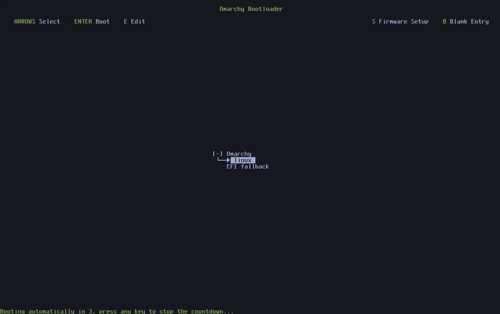

# Updates

Arch and your packages are kept up to date via _Update > Arch_ in the Arch menu (`Super + Space`).

Arch itself is installed as regular pacman packages from the [Arch Package Repository](https://github.com/kairosci/os), so an update installs [the latest Arch release](https://github.com/kairosci/os), installs package-owned system defaults, and updates all system packages from the [Arch Arch Mirror](https://github.com/kairosci/os) and [AUR](https://aur.archlinux.org/) (if you have installed any AUR packages).

When new releases are made, a circle arrow icon will appear to the right of your clock. Click it and the update process will start.

### Four channels

Arch is updated along four channels: stable, RC, edge, and dev. New installations start on the stable channel, which tracks the [official releases](https://github.com/kairosci/os), as well as the [stable Arch Arch mirror](https://github.com/kairosci/os) that's running one month behind the latest, so we can catch any new incompatibilities that require config changes before they cause problems for people.

But if you'd like to help spot those potential issues, you can run on the edge channel. That'll keep your Arch packages tracking the latest development builds, and lets you update to the latest Arch packages as soon as they're available. You should only do this if you're experienced with Linux, and know how to recover a system that has problems.

Before any new major release, we'll be doing final validation using the RC channel. If you're interested in helping with final polishing, come hang out in #arch-release-candidates on the Discord.

Finally, there's the dev channel, which links Arch directly to a git checkout of the source code in `~/arch`, combined with the edge packages. You should only use this channel if you're an experienced Linux user, working directly on Arch, and willing to tolerate breakage.

You can switch between channels using _Update > Channel_ from the Arch menu (or `arch-channel-set` in the terminal).

### Switching kernels

The system uses Arch Linux's `linux` kernel by default. On hardware that needs a specialized kernel, such as Apple T2 Macs and Snapdragon X laptops, the appropriate platform kernel stays available. When multiple kernels are installed, _Update > Kernel_ lists them and marks the one that boots by default. Pick another, enter your password once, and it boots after the next restart. Other installed kernels remain available in the boot menu. In the terminal, use `arch-kernel` to see the current default, `arch-kernel list` for installed kernels, and `arch-kernel set <kernel>` to switch.

### Firmware updates

Your packages aren't the only thing that goes stale. Many laptops and peripherals ship BIOS, SSD, and dock firmware through the Linux Vendor Firmware Service, and _Update > Firmware_ in the Arch menu will fetch and install whatever your hardware has waiting. It installs `fwupd` the first time you run it. Plenty of firmware can only be written during a reboot, so don't be surprised to be asked for one.

### Warning about direct pacman/yay updates

If you're already familiar with Arch, you might be tempted to just run `pacman -Syu` or `yay -Syu` yourself, but if you do that, you'll miss the snapshot, boot verification, and restart checks that Arch runs together with new packages. That's why Arch will actually stop a direct system upgrade and point you to `archctl update` instead. (If you really know what you're doing, the guard will tell you how to bypass it for a single transaction.)

### Rolling back bad updates

If you ever have a problem after doing an update, you can rollback your system to the snapshot taken before the update. Just restart and pick the snapshot in the boot loading menu from before you started the update.

To replace a user configuration with its packaged default, run `archctl refresh config <relative-path>`. The command saves a backup when the file changes. An Arch reinstall also resets all configuration files and overwrites your user changes.
